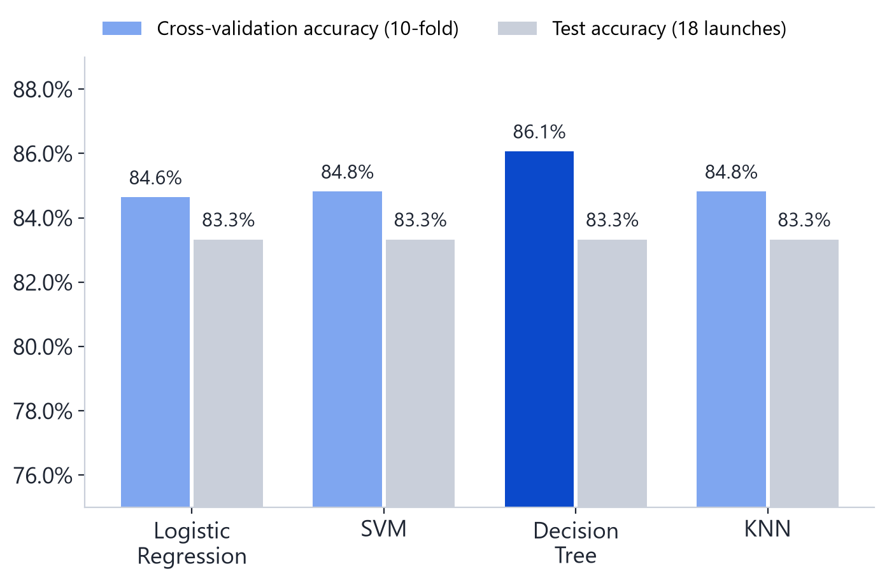
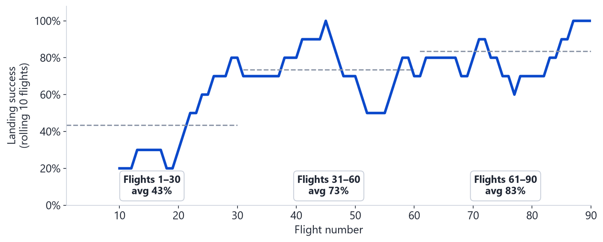
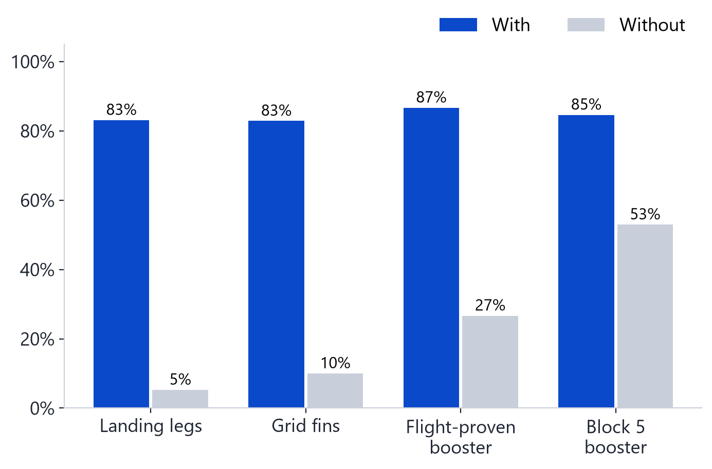
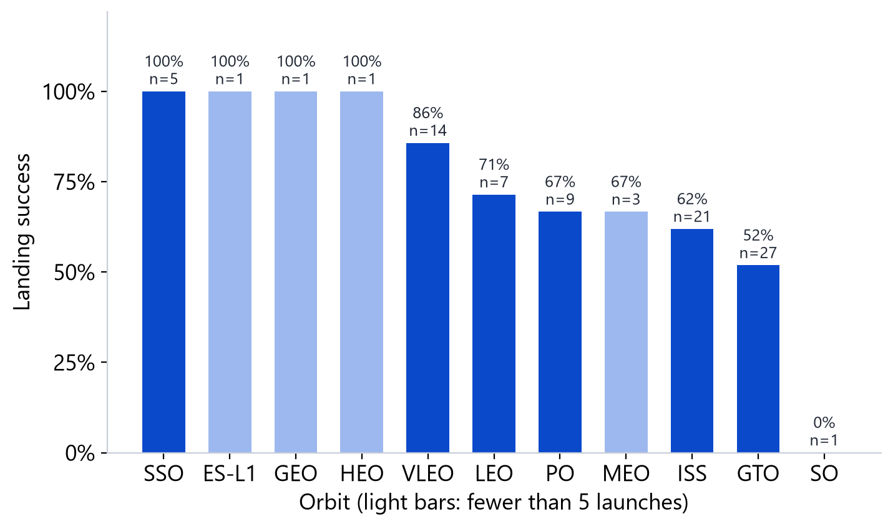
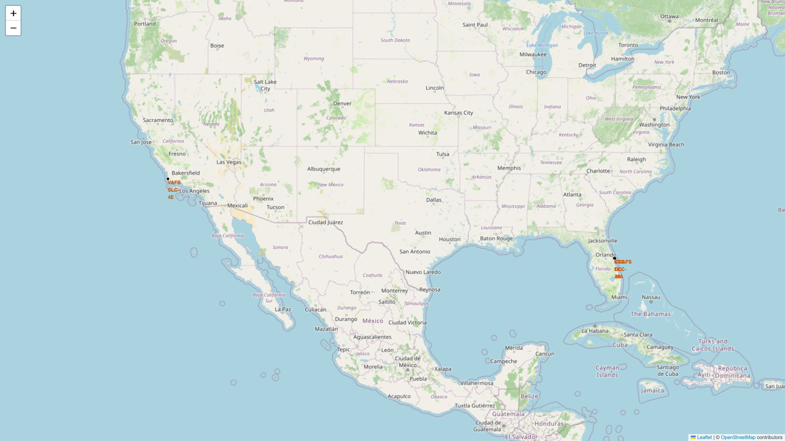
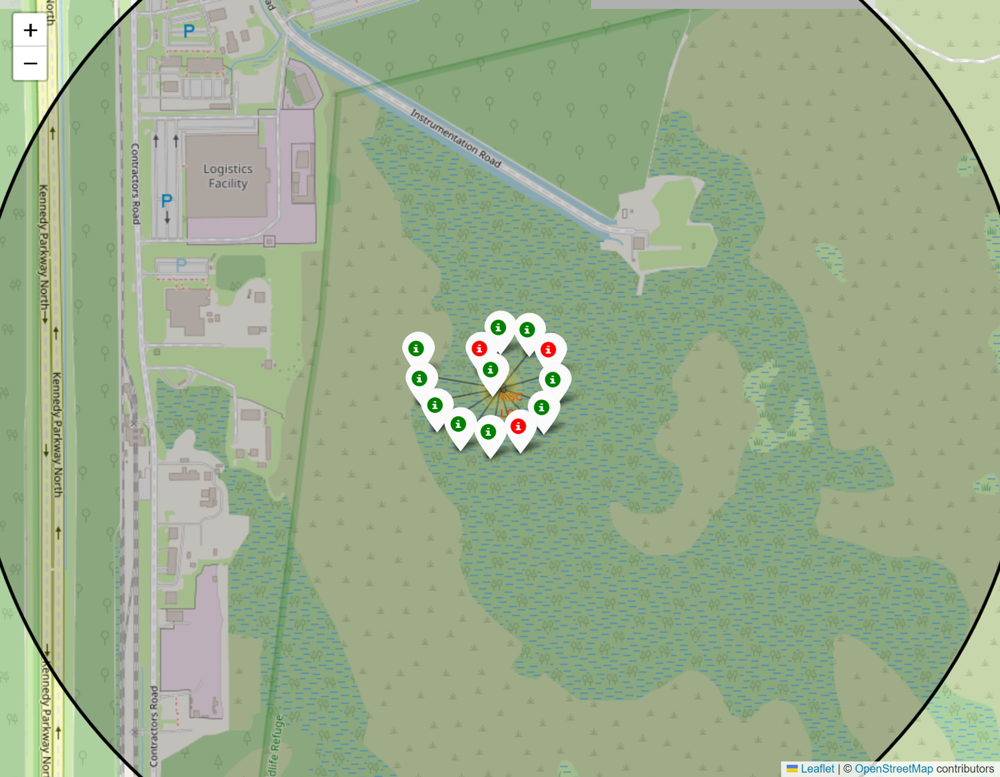
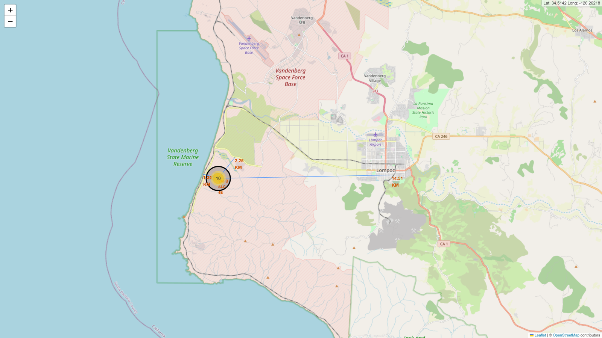
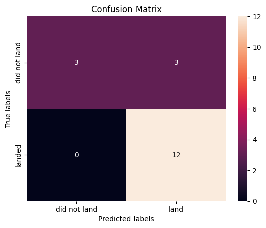
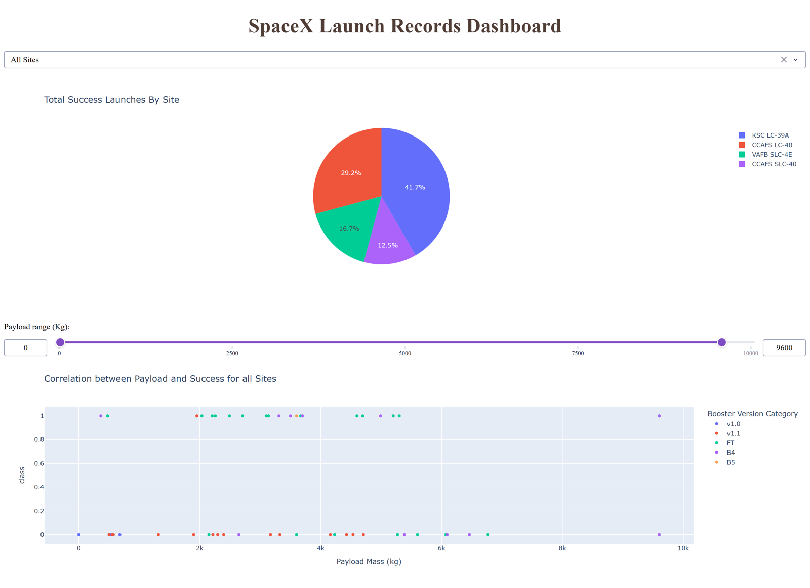

# SpaceX Falcon 9 First-Stage Landing Prediction

SpaceX prices a Falcon 9 launch at about **$62M**, while other providers charge **$165M or more**. Most of that gap comes from landing and reusing the first stage. If you can predict whether the first stage will land, you can estimate what a launch really costs SpaceX, which is useful for any competitor bidding against them.

This project collects public launch data, explores what drives a successful landing, and trains classifiers to predict the outcome. It is my capstone for the [IBM Data Science Professional Certificate](https://www.coursera.org/professional-certificates/ibm-data-science) (graded 100%).

🌐 **[Project page](https://solexj1000.github.io/SpaceX-Falcon-9-first-stage-Landing-Prediction/)** · 📄 **[Full report (PDF)](https://solexj1000.github.io/SpaceX-Falcon-9-first-stage-Landing-Prediction/Data_Science_Capstone_Project_Report.pdf)**

---

## Results at a glance

| | |
|---|---|
| Launches analysed | 90 Falcon 9 flights (2010–2020) |
| Overall landing success | 66.7% |
| Landing success, flights 61–90 | 83% (up from 43% for flights 1–30) |
| Best launch site | KSC LC-39A, 76.9% success |
| Best model | Decision Tree, 86.1% cross-validation accuracy |
| Test accuracy | 83.3% for all four models (15 of 18) |



---

## Key findings

**1. Experience is the biggest driver.** Landing success rose from 43% over the first 30 flights to 73% and then 83%. Every site and orbit improves with flight number, so part of what looks like a payload or site effect is really an experience effect.



**2. Hardware and reuse matter more than payload.** Boosters with landing legs landed 83% of the time, compared with 5% without. Flight-proven (re-used) boosters landed 87% of the time, versus 27% for first-flight cores.



**3. Orbit matters.** ES-L1, GEO, HEO and SSO all landed 100% of the time, but with very few launches. GTO is the hardest of the common orbits at 52%.



**4. Location.** All four launch sites are on the coast and 1–2 km from a railway and highway, but about 15 km from the nearest city. KSC LC-39A has the best record. CCAFS LC-40 has the lowest, partly because most of the early flights launched there.

| Launch sites | Outcomes at KSC LC-39A | Proximities of VAFB SLC-4E |
|---|---|---|
|  |  |  |

**5. The model's mistakes are all false positives.** All four models never missed a real landing, but they predicted a landing for 3 of the 6 failures. So any cost estimate built on them is slightly optimistic.



---

## Interactive dashboard

A Plotly Dash app with a launch-site dropdown and a payload range slider. The dropdown drives a success pie chart and the slider filters a payload vs. outcome scatter plot.



---

## Project structure

| Step | Notebook / file | What it does |
|---|---|---|
| 1 | [01_data_collection_api.ipynb](notebooks/01_data_collection_api.ipynb) | Requests launch data from the SpaceX REST API and cleans it |
| 2 | [02_data_collection_webscraping.ipynb](notebooks/02_data_collection_webscraping.ipynb) | Scrapes the Falcon 9 launch tables from Wikipedia with BeautifulSoup |
| 3 | [03_data_wrangling.ipynb](notebooks/03_data_wrangling.ipynb) | Explores the data and creates the landing label (`Class`) |
| 4 | [04_eda_sql.ipynb](notebooks/04_eda_sql.ipynb) | 10 SQL queries in SQLite |
| 5 | [05_eda_visualization.ipynb](notebooks/05_eda_visualization.ipynb) | Seaborn charts and feature engineering (one-hot encoding) |
| 6 | [06_interactive_map_folium.ipynb](notebooks/06_interactive_map_folium.ipynb) | Folium maps of sites, outcomes and distances |
| 7 | [dashboard/spacex_dash_app.py](dashboard/spacex_dash_app.py) | Plotly Dash dashboard |
| 8 | [07_machine_learning_prediction.ipynb](notebooks/07_machine_learning_prediction.ipynb) | Logistic Regression, SVM, Decision Tree and KNN tuned with GridSearchCV |

```
├── notebooks/     # analysis notebooks, in order
├── dashboard/     # Plotly Dash app + its dataset
└── docs/          # project web page (GitHub Pages), report PDF and images
```

> GitHub does not render the interactive Folium maps inside notebooks. The map screenshots above show what they look like.

---

## How to run

```bash
git clone https://github.com/SolexJ1000/SpaceX-Falcon-9-first-stage-Landing-Prediction.git
cd SpaceX-Falcon-9-first-stage-Landing-Prediction
pip install -r requirements.txt

jupyter notebook            # open any notebook in notebooks/

cd dashboard
python spacex_dash_app.py   # then open http://127.0.0.1:8050
```

Notebooks 05–07 were written for IBM's browser-based JupyterLite environment and load data with `piplite` and `js.fetch`. To run them in regular Jupyter, replace those lines with `pd.read_csv(URL)`.

**Note on the SpaceX API:** the public API (`api.spacexdata.com`) has been returning HTTP 522 errors since October 2026. Notebook 01 checks whether the API is available. If it isn't, the notebook uses the course's pre-built output of the same API calls (`dataset_part_1.csv`), so every later step is unchanged.

---

## Tools

Python · pandas · NumPy · requests · BeautifulSoup · SQLite / SQL · Matplotlib · Seaborn · Folium · Plotly Dash · scikit-learn

## Author

**Joseph Appolos**, [GitHub @SolexJ1000](https://github.com/SolexJ1000)

Datasets and lab templates are from the IBM Skills Network *Applied Data Science Capstone* course on Coursera.
